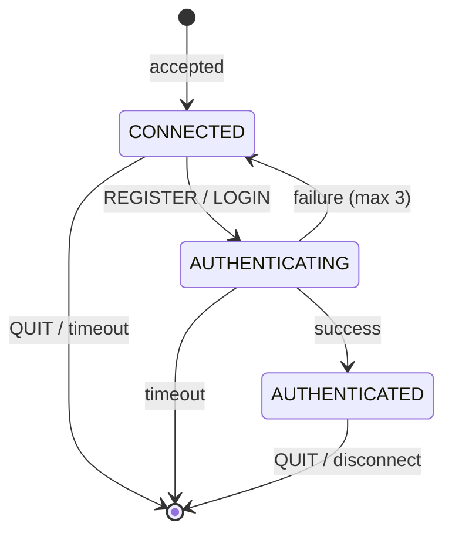
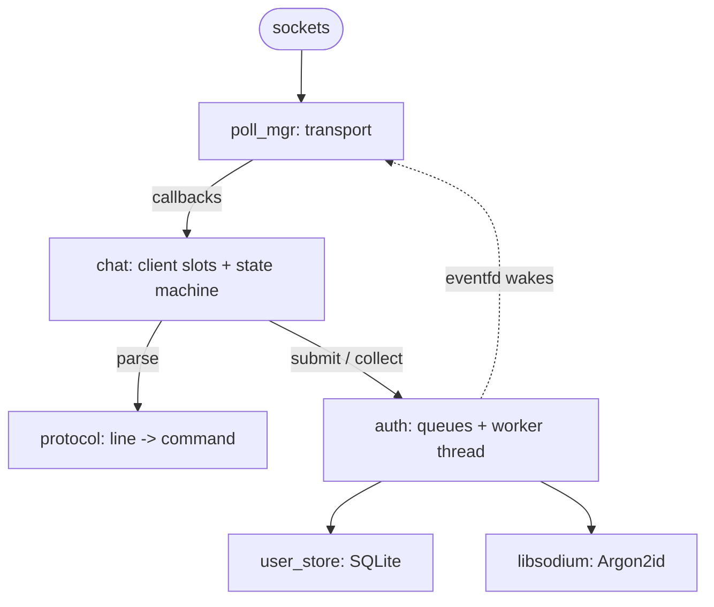

# Messenger

A client-to-client chat server written in C. Users register an account, log in,
and send direct messages to other users who are online. The server is a single
`poll()` event loop; password hashing runs on a worker thread so it never stalls
the chat traffic.

> **Security warning: there is no TLS.** Passwords and messages travel as
> plaintext over TCP. The server binds to `localhost` by default and should stay
> that way. Passing `0.0.0.0` (or any non-loopback address) exposes a plaintext
> server to the network. Use it for learning and local testing only.

## Status

| Part | State |
|------|-------|
| Server | Complete: registration, login, direct messages, SQLite user store, Argon2id hashing, worker-thread auth |
| Client | **Stub.** `client/main.c` only prints `Client Initialized...`. Use `nc`/`telnet` or a script (see below) |
| Not implemented | TLS, offline message storage, rate limiting per IP, password policy, password change |

## Features

- Line-based text protocol (`REGISTER`, `LOGIN`, `MSG`, `QUIT`), easy to drive with `nc`.
- Accounts persisted in SQLite; passwords stored only as Argon2id hashes (libsodium).
- Case-insensitive usernames (`Alice` and `alice` are the same account).
- Unknown user and wrong password give the same error and cost the same time
  (a dummy hash is verified), so login does not reveal which names exist.
- Authentication runs on a dedicated worker thread and wakes the event loop through an `eventfd`.
- Non-blocking I/O with bounded per-client output queues; a slow recipient is
  never kicked by a flood (the sender gets `ERR recipient busy`).
- Clean shutdown on `SIGINT`/`SIGTERM`.
- Test suites (cmocka) plus ASan/UBSan and ThreadSanitizer presets.

## Requirements

- Linux (uses `poll`, `eventfd`, `getentropy`)
- C11 compiler (GCC or Clang), CMake >= 3.28, Ninja, pkg-config
- SQLite3 (>= 3.38, for `unixepoch()`), libsodium, pthreads
- cmocka (tests only)
- Optional: Doxygen + Graphviz (API docs)

Arch Linux:

```sh
sudo pacman -S base-devel cmake ninja pkgconf sqlite libsodium cmocka doxygen graphviz
```

## Build

CMake presets are provided; each builds into `build/<preset>`.

```sh
cmake --preset debug
cmake --build --preset debug
```

| Preset | Purpose |
|--------|---------|
| `debug` | Daily development (`-O0 -ggdb`) |
| `asan` | AddressSanitizer + UBSan: memory errors |
| `tsan` | ThreadSanitizer: data races (cannot be combined with ASan) |
| `release` | `-O3 -DNDEBUG` |

All targets are compiled with `-Wall -Wextra -Wpedantic -Wconversion -Wsign-conversion`.
The server binary is `build/<preset>/server/server`.

API documentation (Doxygen) is available as a `docs` target when Doxygen is
installed: `cmake --build --preset debug --target docs`.

## Run

```sh
build/debug/server/server [-b backlog] [-l logfile] [-d dbpath] [-v] [host] [port]
```

| Option | Meaning | Default |
|--------|---------|---------|
| `-b N` | `listen()` backlog (0..INT_MAX) | `10` |
| `-l FILE` | Also append log lines to `FILE` (stderr is always used) | none |
| `-d PATH` | SQLite database file (created if missing) | `./messenger.db` |
| `-v` | Verbose (DEBUG) logging | off |

Positionals follow `nc`: one argument is the **port**, two are **host then port**,
more is an error. Options must come first for predictable results. Defaults:
host `localhost`, port `8000`. The port must be 1-65535.

```sh
build/debug/server/server                  # localhost:8000
build/debug/server/server 9000             # localhost:9000
build/debug/server/server 127.0.0.1 9000  # explicit IPv4 loopback
build/debug/server/server -d /tmp/chat.db -l server.log -v
```

Notes:

- `localhost` may resolve to `::1` and/or `127.0.0.1`. The server binds the
  **first** address that works, so `nc localhost 8000` may succeed where
  `nc 127.0.0.1 8000` is refused. Pass `127.0.0.1` explicitly if you need IPv4.
- If the port is already in use the server exits with 69 and does not try other addresses.
- There is no `--help`; a bad option prints the usage line and exits with 64.

### Exit codes

| Code | Meaning |
|------|---------|
| 0 | Clean stop after `SIGINT`/`SIGTERM` |
| 64 | Usage error (bad option, backlog, port, extra argument) |
| 68 | Host could not be resolved |
| 69 | Address in use / no address could be bound |
| 70 | libsodium failed to initialise |
| 71 | OS error (`setsockopt`, `listen`, `sigaction`, `poll`, poll manager init) |
| 73 | Log file could not be opened |
| 74 | Database could not be opened |

### Logging

Lines look like `2026-10-28 12:00:00 INFO  [chat] message` and go to stderr
(and to `-l FILE`). Passwords and credential-bearing lines are never logged.

## Quick try with `nc`

Terminal 1: `build/debug/server/server`

Terminal 2: `nc localhost 8000`

```
REGISTER alice hunter2
OK
```

Terminal 3: `nc localhost 8000`

```
REGISTER bob pw123
OK
MSG alice hello there
OK
```

Terminal 2 now receives:

```
FROM bob hello there
```

## Protocol

Text lines terminated by `\n`. Commands are uppercase and case-sensitive.
Fields are separated by **exactly one space**.

### Commands (client to server)

| Command | Description |
|---------|-------------|
| `REGISTER <user> <pass>` | Create an account and log in |
| `LOGIN <user> <pass>` | Log in to an existing account |
| `MSG <user> <text>` | Send `<text>` to an online user. The text keeps its spaces |
| `QUIT` | Reply `OK` and disconnect |

### Replies and pushes (server to client)

| Line | Meaning |
|------|---------|
| `OK` | Success (register/login, message handed to the recipient, `QUIT`) |
| `FROM <sender> <text>` | A message for you, from an online user |
| `ERR <reason>` | Failure, see below |

| `ERR` reason | When |
|--------------|------|
| `unknown command` | First token is not a command |
| `missing field` | Empty line, or a required field is missing/empty (including all-space `MSG` text) |
| `too long` | Field over its limit, or a line over 1023 bytes (connection stays open) |
| `bad input` | Non-printable/non-ASCII byte (including `\r`), bad username characters, or trailing input after `REGISTER`/`LOGIN`/`QUIT` |
| `not allowed` | Command not valid in the current state, or `MSG` to yourself |
| `busy` | A command arrived while a previous `REGISTER`/`LOGIN` is still being processed, or the auth queue is full |
| `bad credentials` | Unknown user or wrong password (deliberately indistinguishable) |
| `name taken` | `REGISTER` of an existing name |
| `already logged in` | That name is already online |
| `too many failed attempts` | Third failure; connection closed |
| `timeout` | Not authenticated within 120 s of connecting; connection closed |
| `server full` | All 100 slots are used; connection closed |
| `no such user` | Recipient is not online (messages are dropped, not stored) |
| `recipient busy` | Recipient's output queue is full |
| `internal issue` | Server-side failure; connection closed |

Parse errors are reported in any state and take precedence over state errors.
They never count as failed login attempts.

### Rules and limits

| Item | Rule |
|------|------|
| Characters | Printable ASCII only (0x20-0x7E), including message text |
| Username | 1-32 characters from `A-Za-z0-9_-`, case-insensitive; a session keeps the casing typed at login |
| Password | 1-128 printable ASCII characters, no spaces |
| Message text | 1-200 characters |
| Line length | 1023 bytes; longer lines get `ERR too long` |
| Line ending | `\n` only. A client sending `\r\n` gets `ERR bad input`; configure `nc`/`telnet` accordingly |
| Clients | 100 simultaneous connections |
| Failed attempts | 3 per connection (`bad credentials` or `already logged in` count; `name taken` and parse errors do not), then disconnect |
| Unauthenticated timeout | 120 s from connect (not idle time), checked on a 1 s tick |
| Output queue | 16 KiB per client |

### Client states



| State | Allowed | Anything else |
|-------|---------|---------------|
| CONNECTED | `REGISTER`, `LOGIN`, `QUIT` | `MSG` gives `ERR not allowed` |
| AUTHENTICATING | nothing (even `QUIT`) | `ERR busy` |
| AUTHENTICATED | `MSG`, `QUIT` | `REGISTER`/`LOGIN` give `ERR not allowed` |

The auth result is applied on the next event-loop tick after the worker finishes,
so the `OK`/`ERR` for a `REGISTER`/`LOGIN` may arrive up to about a second later
(typically sooner, since the worker wakes the loop).

### Message routing

1. Recipient must be an **authenticated** online user (case-insensitive), else `ERR no such user`.
2. Messaging yourself gives `ERR not allowed`.
3. The recipient gets `FROM <your name> <text>`; you get `OK`.
4. If the recipient's queue is full you get `ERR recipient busy` (they are not disconnected).
   If their socket is dead they are closed and you get `ERR no such user`.

## Architecture



- **`poll_mgr`** owns the sockets and knows nothing about users. One thread, one
  `poll()` per iteration with a 1 s timeout; `on_tick` runs after every return.
  Slot 0 is the listener, slot 1 the auth wake fd, slots 2+ clients. Closing is
  deferred (flag, then a sweep after the tick) so slots are never removed mid-dispatch.
- **`chat`** holds the per-client state machine, MSG routing and timeouts. It talks
  to the transport only through `poll_mgr_send`/`poll_mgr_close`. Each connection
  gets a random UUID v4 (`getentropy`) used to match asynchronous auth results to
  the right slot.
- **`protocol`** is pure: bytes in, command struct out; plus reply formatters.
- **`auth`** exposes `auth_submit` / `auth_collect`. Requests go into a bounded
  ring (300 entries in total across queued, running and uncollected), one worker
  thread runs the Argon2id hash and the SQLite query, and writes to an `eventfd`
  that wakes `poll()`. A single mutex guards the rings; hashing and SQL never run
  under it. `auth_shutdown` stops and joins the worker before the database closes.
- **`user_store`** wraps SQLite (opaque handle, prepared statements, WAL,
  5 s busy timeout). Only the hash string is stored.
- **`log`**, **`cli_args`**, **`main_socket`**, **`uuid`** are small support modules.

### Password handling

- libsodium `crypto_pwhash_str` (Argon2id) with the INTERACTIVE preset (about
  64 MiB and roughly 0.1 s per hash). The salt and parameters live inside the stored string.
- Password buffers are wiped with `sodium_memzero` after use.
- Because hashing is serial on one worker, a flood of logins is throttled but can
  fill the auth queue (clients then see `ERR busy`).

### Database

```sql
CREATE TABLE IF NOT EXISTS users (
  id         INTEGER PRIMARY KEY,
  username   TEXT NOT NULL UNIQUE COLLATE NOCASE,
  pass_hash  TEXT NOT NULL,
  created_at INTEGER NOT NULL DEFAULT (unixepoch())
);
```

A database created by an older development build may hold plaintext "hashes" or a
case-sensitive username column; delete `messenger.db*` to start fresh.

## Repository layout

```
CMakeLists.txt, CMakePresets.json   build configuration and presets
client/                             stub client
server/main.c                       startup, signals, shutdown
server/include/server/*.h           public headers (Doxygen documented)
server/src/                         auth, chat, cli_args, log, main_socket,
                                    poll_mgr, protocol, user_store, uuid
tests/                              cmocka suites; tests/chat/ shares chat_fixture.h
.clang-format, .clang-tidy,         formatting, static analysis, pre-commit hooks
.pre-commit-config.yaml
```

## Testing

```sh
cmake --preset debug && cmake --build --preset debug && ctest --preset debug
```

Ten suites (about 95 cases) cover the CLI, protocol, auth worker, UUIDs, user store,
poll manager and the chat state machine (real `poll_mgr` + `chat` + `auth` on an
in-memory database, using socketpairs as clients). Tests hash at a fast
cost setting (`auth_set_hash_cost`, never used by the server). Run the same
commands with `asan`, `tsan` (repeats each test 20 times) and `release`.

## Development

```sh
pip install pre-commit && pre-commit install
```

The hooks run clang-format and clang-tidy (needs `build/<preset>/compile_commands.json`)
on `client/` and `server/`.

## Known limitations

- Plaintext transport; no TLS.
- No per-IP rate limiting (only the 3-attempt disconnect); no password policy
  beyond length; no rehash-on-login or password change.
- `REGISTER` reveals whether a name exists (`ERR name taken`).
- Messages to offline users are dropped, not stored.
- Shutdown stops the loop and exits; connected clients are not notified.
- Message text is ASCII only (no UTF-8).
- Linux only.
